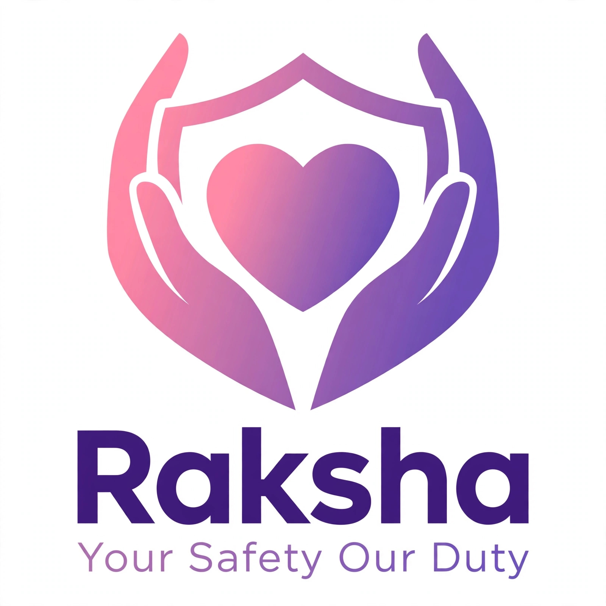

  

# 🛡️ RAKSHA - Women Safety App

### Founded by Angoth Rameshwari
### MNR College of Nursing, Sangareddy, Telangana

> **My Mission: To make every woman in India feel safe.**

---

### 👩‍⚕️ About Founder
**Name:** Angoth Rameshwari
**College:** MNR College of Nursing, Sangareddy
**Course:** GNM
**Location:** Medak,Telangana
**Dream:** To protect women through technology

### 🌸 What is RAKSHA?
RAKSHA is a women safety app designed to provide instant help during emergency situations. With one click SOS, live location sharing, and trusted contacts alert.

### ✨ Features
- 🚨 One Click SOS Emergency Alert
- 📍 Live Location Sharing
- 👨‍👩‍👧‍👦 Trusted Contacts
- 📞 Direct Call to Police & Family
- 🔒 Safe & Secure

### 💜 Founder Message
I am a nursing student. I see many women facing safety issues daily. I created RAKSHA to give every sister, mother, daughter a shield of safety.

**Jai Hind, Jai Telangana!**

---
© 2026 RAKSHA by Rameshwari | All Rights Reserved
